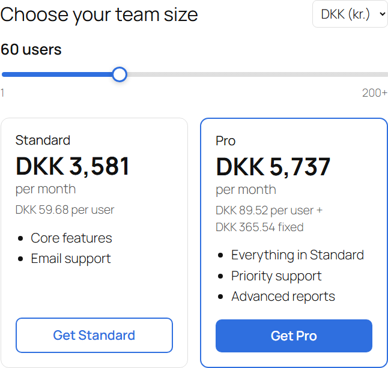
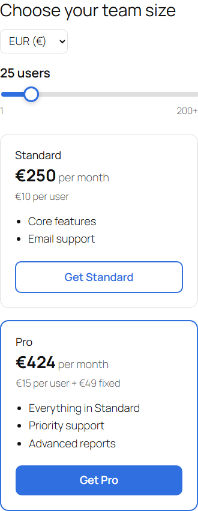
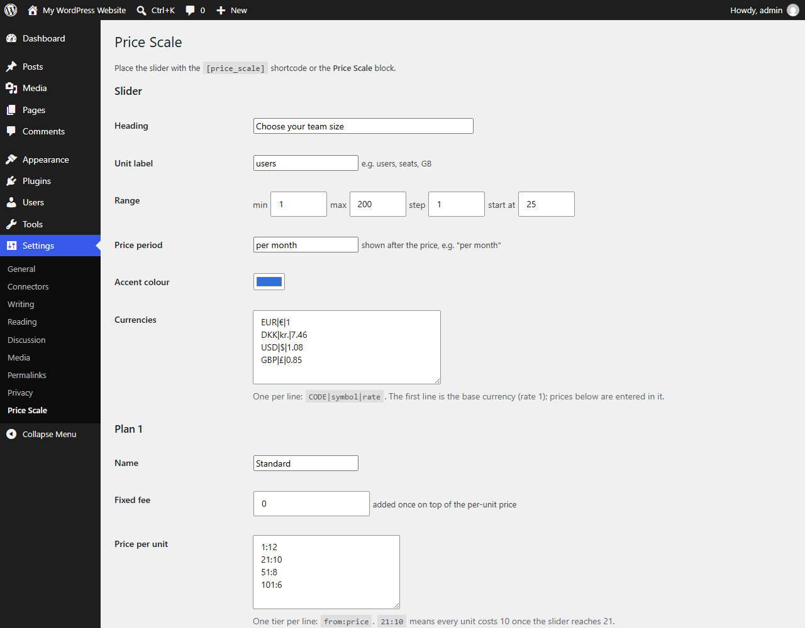

# Price Scale Slider (WordPress plugin)

An interactive sliding-scale pricing widget for WordPress: visitors drag to a quantity and see two plans' prices update live, in the currency they pick. Everything is edited in **Settings > Price Scale**, and the widget is placed with the `[price_scale]` shortcode or the **Price Scale** block.

**Live demo:** https://luoy16002-svg.github.io/price-scale-slider/

| Running inside WordPress | Mobile |
|---|---|
|  |  |

## Features

- Range with editable min, max, step and starting value; the label reads "60 users", "500 GB" and so on.
- Two plans, each with a fixed fee plus a per-unit price that drops in volume tiers (`21:10` means every unit costs 10 once the slider reaches 21).
- Currency selector with editable rates (the first currency is the base the prices are entered in); amounts are formatted for each currency.
- Plan features and call-to-action buttons.
- Inherits the theme's fonts, headings and text colour; only the accent colour is set by the plugin. Responsive, keyboard accessible (native range input with readable values).
- No jQuery or framework: about 5 KB of JavaScript, loaded only on pages that show the widget.
- Settings are sanitised on save; output is escaped.

## Install

Download `price-scale-slider.zip`, then **Plugins > Add New > Upload Plugin**, activate it, set your prices under **Settings > Price Scale**, and add `[price_scale]` (or the Price Scale block) to a page.

## Tested

In a local WordPress 6 install (WordPress Playground): plugin activation, the shortcode on a page, the settings page, and the live calculation:

- 25 users, EUR: Standard €250 (25 × €10), Pro €424 (25 × €15 + €49)
- 60 users, DKK: Standard DKK 3,581 (60 × €8 × 7.46), Pro DKK 5,737
